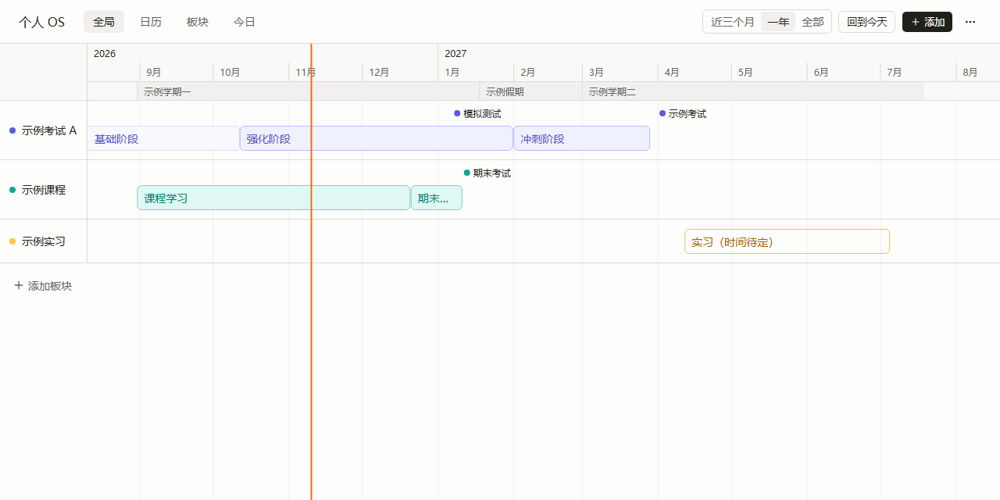

# Kairos OS（个人 OS）

一个长期使用的个人规划系统：打开就能看到各个板块现在处在哪个阶段、下一个节点还有几天，再展开到一张可编辑的泳道时间线。

在线地址：<https://rsluna7.github.io/personal-os/>



## 功能

- **全局页**：最上面是“现在”摘要（今天、进行中的阶段数、下一个节点的倒计时）；中间是时间线卡片，只看不改，点“展开”进入完整编辑；下面是板块概览，每个板块一张卡，显示当前阶段、进度和接下来的安排。
- **板块页**：左边选板块，右边是它的备注、资料链接、按时间排列的阶段和节点；增删改都在页面里完成。
- **日历页**：一个月一屏，每天是一张圆角卡片，里面只放当天的待办和节点。待办是“细色条加标题”，色条用所属板块的颜色（不挂板块是灰色），完成后变淡加删除线；格子都是中性的白底，颜色只在条目上；今天是橙色边框加实心日期徽标。一格最多直接显示三条，多出来的在右上角写“+N”，点它把这一格放大成一张卡片，看这一天的全部条目。
- **待办**：在日历格子的空白处双击新建，悬停时点右侧的勾选控件完成，点标题打开编辑面板（标题、日期、板块、完成、删除），拖到别的日期改期。没有日期的待办放在日历右侧的“未安排”列表里，可以直接在那里添加，也可以拖进某一天；挂了板块的待办在板块被删除后不会消失，只是变成不挂板块。
- **泳道时间线**：每个板块一行，阶段是色块，节点是圆点，一条橙色竖线标出今天。正在进行的阶段是实心色块。
- **直接编辑**：拖动色块平移，拖动两端改起止，按周吸附；在空白处双击新建阶段；单击打开编辑面板。
- **待确认阶段**：还没定下来的安排画成虚线框。已经结束的阶段自动变淡。
- **学期标尺**：在时间标尺下方显示学期，用来对照各阶段处在哪个学期。
- **撤销与重做**：所有修改都可以撤销，删除后底部有“撤销”提示条。
- **缩放和平移**：三档预设（近三个月、一年、全部），`Ctrl + 滚轮` 连续缩放，横向滚轮或按住空白处拖动来平移。
- **备份**：导出为 JSON 文件，导入时整体校验；超过 30 天没导出会有提醒。

今日视图还没做，导航里显示“待开发”。

## 数据存在哪里，如何备份

数据只存在**你当前这个浏览器**的本地存储（`localStorage`）里，不会上传到任何地方，这个仓库里也不包含任何个人数据。

这意味着清除浏览数据、换浏览器或换电脑后数据就没有了。唯一的保护是导出备份：

1. 点右上角“⋯” → **导出备份**，得到 `personal-os-日期.json`。
2. 需要恢复时，点“⋯” → **导入备份**，选择这个文件。导入会整体替换当前数据，可以撤销。

“⋯”按钮上出现小圆点，表示距上次导出已超过 30 天。

如果页面提示“数据读取失败”，原数据不会被改动：先点“下载原始数据”留底，再用“导入备份”恢复。

## 键盘快捷键

时间线：

| 按键                    | 作用                   |
| ----------------------- | ---------------------- |
| `Tab`                   | 在色块和节点间移动焦点 |
| `Enter`                 | 打开编辑面板           |
| `←` `→`                 | 选中项前后移动一周     |
| `Shift + ←` `Shift + →` | 调整选中阶段的结束日期 |
| `Delete`                | 删除选中项             |
| `Esc`                   | 关闭面板或取消选中     |
| `T`                     | 回到今天               |
| `Ctrl + Z`              | 撤销                   |
| `Ctrl + Shift + Z`      | 重做                   |

日历：

| 按键                            | 作用                                       |
| ------------------------------- | ------------------------------------------ |
| `Tab`                           | 进入日期格；再按进入格子里的待办和节点     |
| `←` `→` `↑` `↓`（焦点在日期格） | 前后一天、上下一周，越过月末自动翻月       |
| `Enter`（焦点在日期格）         | 在这一天新建待办并开始输入标题             |
| `PageUp` `PageDown`             | 上个月、下个月                             |
| `T`                             | 回到今天                                   |
| `Enter`（焦点在待办或节点）     | 打开编辑面板                               |
| `空格`（焦点在待办）            | 勾选或取消完成                             |
| `←` `→` `↑` `↓`（焦点在条目）   | 把待办或节点改到前一天、后一天、上周、下周 |
| `Delete`（焦点在条目）          | 删除，底部有“撤销”提示条                   |
| `Esc`                           | 关闭面板，或取消选中节点                   |
| `Ctrl + Z` `Ctrl + Shift + Z`   | 撤销、重做                                 |

## 本地开发

需要 Node.js 24。

```bash
npm install
npm run dev        # 本地开发，打开终端提示的地址
npm test           # 运行测试
npm run lint       # 代码检查和格式检查
npm run typecheck  # 类型检查
npm run build      # 构建到 dist/
npm run check:size # 检查打包后的脚本体积（压缩后不超过 200 KB）
```

推送到 `main` 后，GitHub Actions 会自动检查并发布到 GitHub Pages。

## 目录

```
src/
  app/                 外壳：顶栏、导航、路由、“⋯”菜单、出错界面
  features/
    home/              全局页：摘要带、时间线卡片、板块概览
    lane/              板块页：板块列表、备注、资料链接、阶段与节点列表
    calendar/          日历页：日期卡片、待办与节点、未安排列表、拖动、键盘
    timeline/          时间线：日期换算、吸附、分行、渲染、拖动、快捷键
    editor/            编辑面板、板块菜单、学期编辑、撤销提示条
  data/                数据结构和校验、状态和撤销、本地存储、版本升级、导出导入
  styles/tokens.css    颜色对照表和动效参数
  components/ui/       shadcn/ui 组件
docs/superpowers/      设计文档和实施计划
```

约定：`data/` 不依赖界面代码；日期换算、吸附、分行都是纯函数；颜色只通过 `tokens.css` 里的语义变量使用。

## 技术栈

Vite、React、TypeScript、Tailwind CSS、shadcn/ui、Radix Colors、Zustand、Zod、Vitest。字体是自带的 Inter、思源黑体和思源宋体（`@fontsource-variable`），不依赖在线字体服务。

## 许可证

[MIT](LICENSE)
